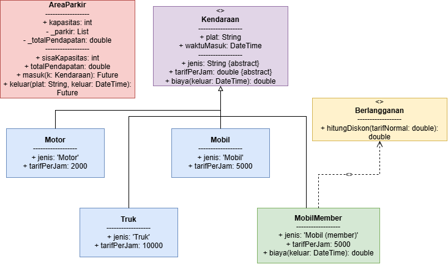
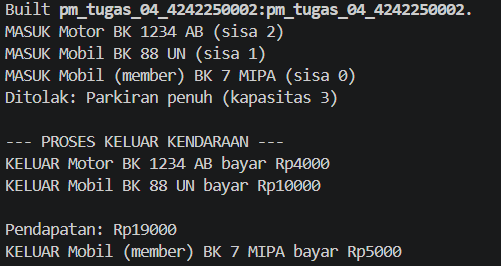

# Sistem Parkir Kampus (Console Dart) - Tugas Rutin 4

## A. Identitas
* **Nama:** Khodotun Hadawiyah.M
* **NIM:** 4242250002
* **Mata Kuliah:** Pemrograman Mobile

## B. Diagram Kelas Sederhana
Berikut adalah rancangan diagram kelas (*class diagram*) yang menggambarkan relasi pewarisan dan mixin pada sistem parkir:

## C. Tangkapan Layar Keluaran Program
Berikut adalah tangkapan layar terminal yang menunjukkan hasil eksekusi program (kendaraan masuk, penolakan saat area penuh, proses keluar, serta rekapitulasi total pendapatan):

## D. Penjelasan Teknis (Enkapsulasi, Polimorfisme, dan Async)
Pada pengembangan sistem parkir kampus ini, penerapan konsep *Object-Oriented Programming* dan *Asynchronous Programming* diimplementasikan secara terstruktur. Pertama, **enkapsulasi** diterapkan pada kelas `AreaParkir` dengan menyembunyikan daftar data kendaraan ke dalam list privat (`_parkir`) dan akumulasi finansial ke variabel `_totalPendapatan`, sehingga akses modifikasi data dikontrol secara aman melalui *getter* publik seperti `sisaKapasitas` dan `totalPendapatan`. Kedua, **polimorfisme** dimanfaatkan melalui penggunaan tipe referensi umum `Kendaraan` yang menampung berbagai objek nyata (`Motor`, `Mobil`, `MobilMember`, dan `Truk`). Ketika method biaya dipanggil, Dart mengeksekusi rumus dan diskon khusus secara dinamis sesuai bentuk objek aslinya. Ketiga, **async programming** diterapkan pada method `masuk` dan `keluar` dengan menggunakan `Future.delayed` untuk mensimulasikan jeda waktu kerja palang otomatis, serta memanfaatkan `StreamController.broadcast()` untuk memancarkan setiap kejadian secara *real-time* kepada *listener* di pos jaga.

## E. Pernyataan Penggunaan AI
Pernyataan Penggunaan AI: Bantuan kecerdasan buatan digunakan sebagai referensi pendukung dalam merancang struktur logika OOP, pengaplikasian fungsi asinkron berbasis *stream*, pembuatan skema diagram kelas, serta penyusunan dokumentasi laporan ini.